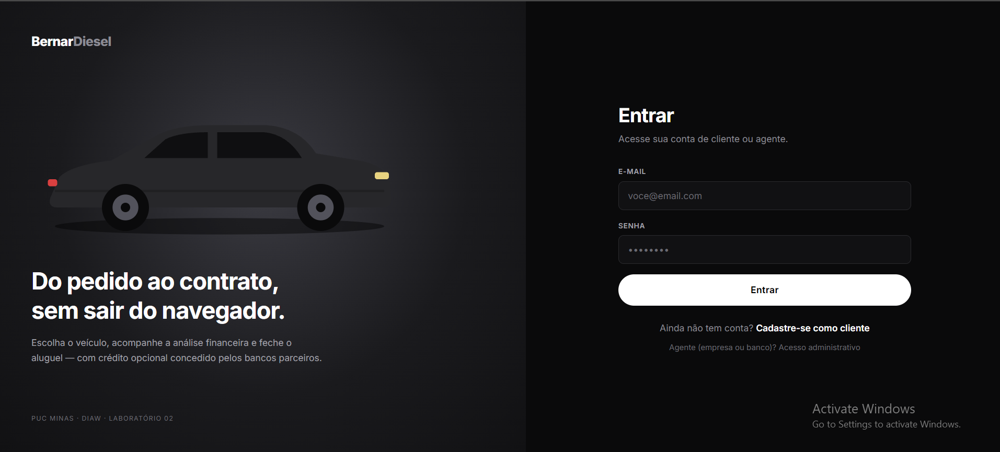
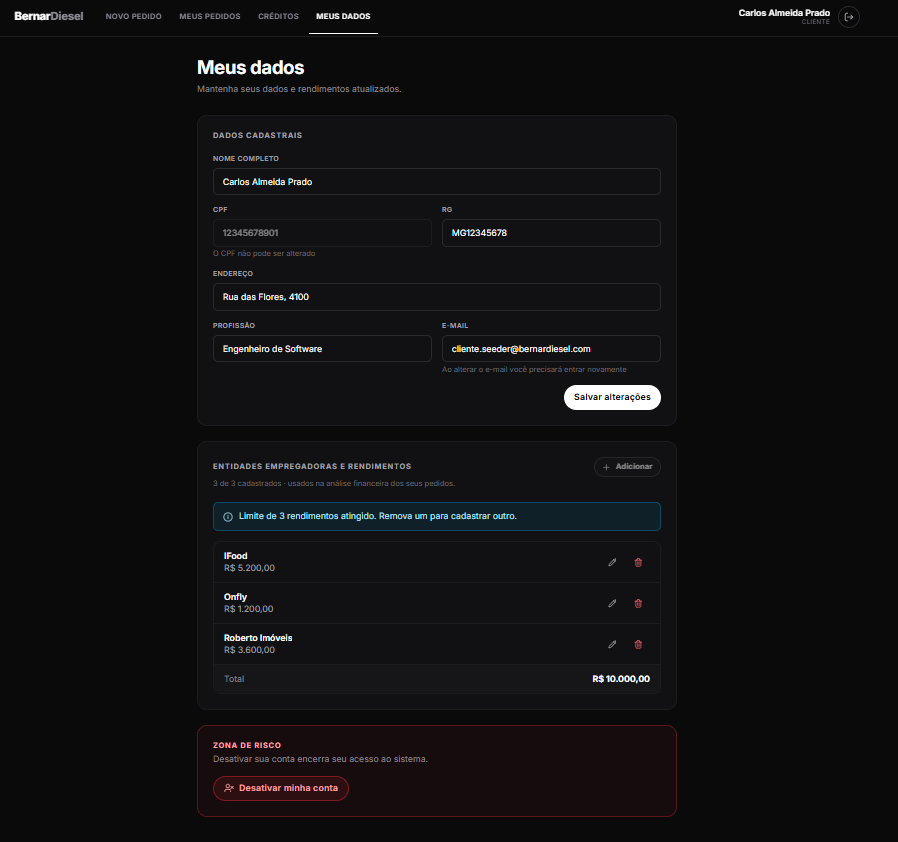
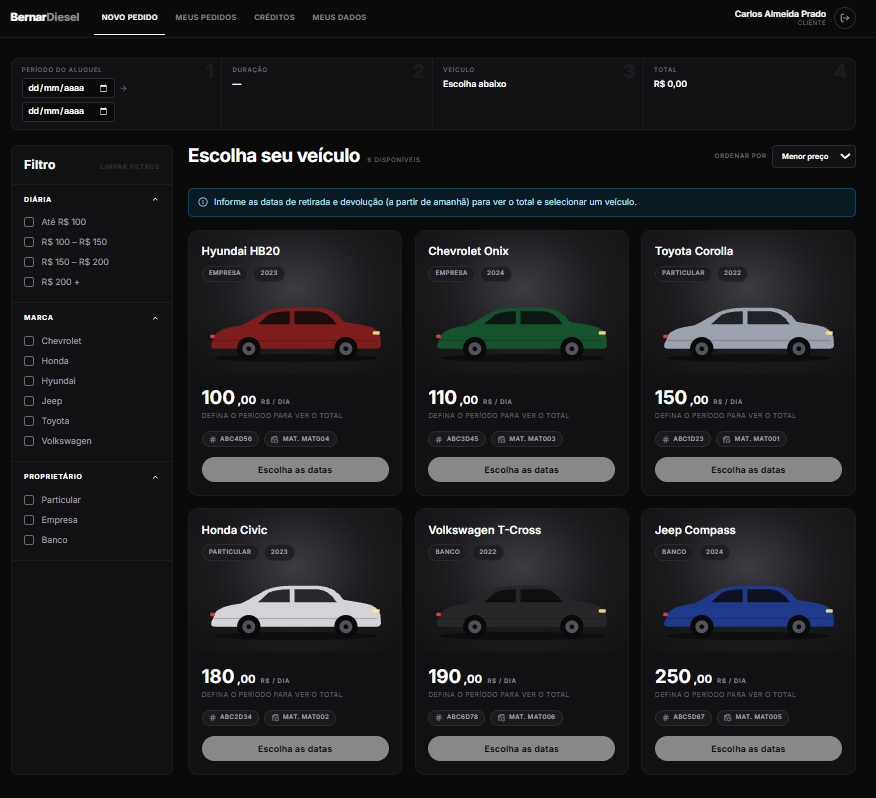
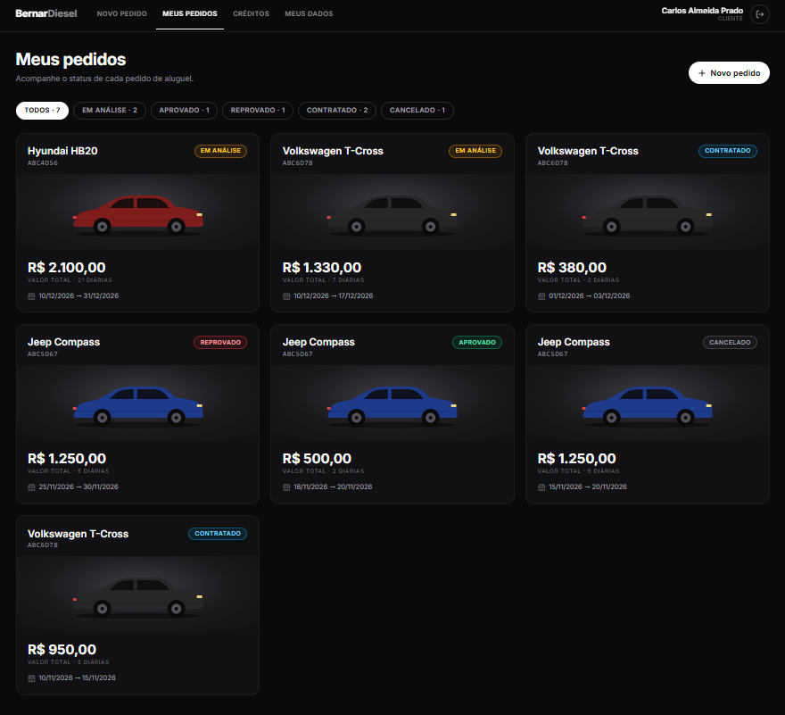
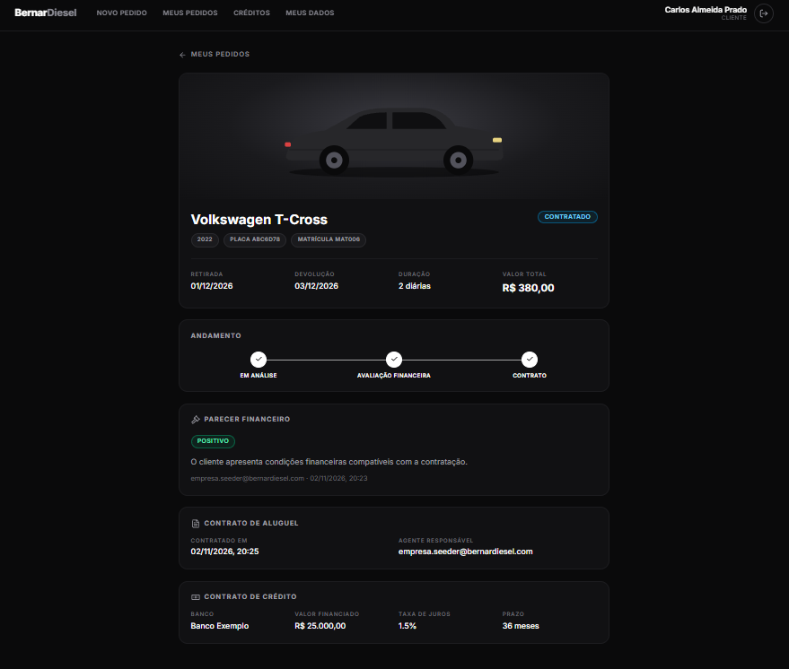
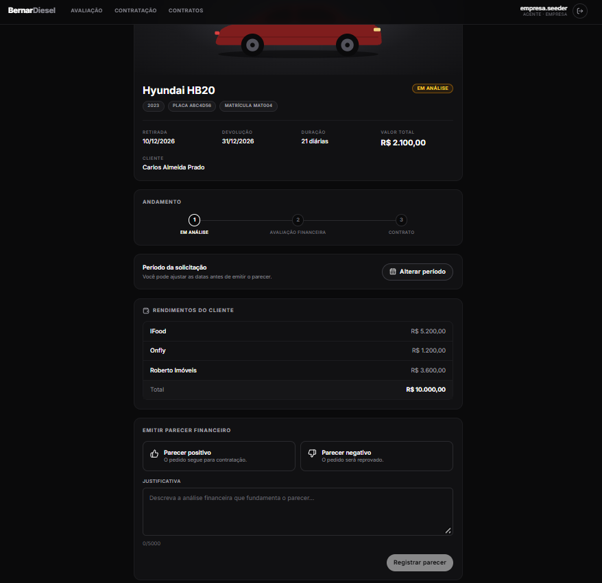
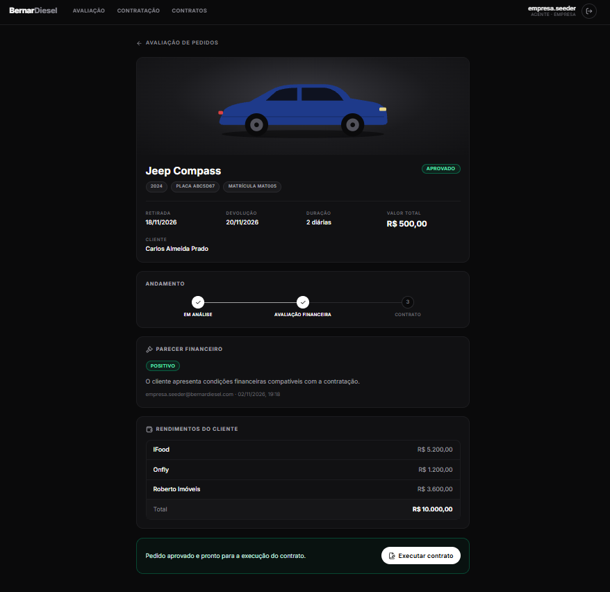
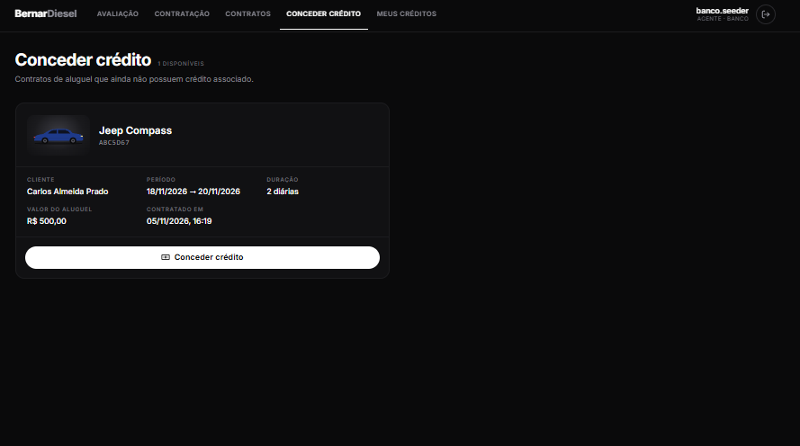

# 🚛 BernarDiesel 👨‍💻

<table>
  <tr>
    <td width="800">
      <div align="justify">
        Sistema web de aluguel de carros que conecta clientes, empresas e bancos em uma única plataforma, permitindo que clientes solicitem o aluguel de veículos, acompanhem o andamento de suas solicitações e tenham suas condições financeiras avaliadas pelos agentes responsáveis. O sistema contempla a análise de crédito, a aprovação ou reprovação dos pedidos, a formalização dos contratos de aluguel e, quando necessário, a concessão de crédito por instituições financeiras, proporcionando um processo integrado, organizado e seguro para todas as partes envolvidas.
      </div>
    </td>
    <td width="150" align="center">
      <div>
        
      </div>
    </td>
  </tr>
</table>

---

## 🚧 Status do Projeto


---

## 📚 Índice

- [Sobre o Projeto](#-sobre-o-projeto)
- [Funcionalidades Principais](#-funcionalidades-principais)
- [Tecnologias Utilizadas](#-tecnologias-utilizadas)
- [Arquitetura](#-arquitetura)
- [Instalação e Execução](#-instalação-e-execução)
- [Estrutura de Pastas](#-estrutura-de-pastas)
- [Demonstração](#-demonstração)
- [Autor](#-autor)
- [Licença](#-licença)

---

## 📝 Sobre o Projeto

O **BernarDiesel** é um sistema web para apoiar a gestão de aluguéis de automóveis. Ele permite **efetuar, modificar e cancelar pedidos de aluguel pela Internet**, com análise financeira feita pelos agentes (empresas e bancos) antes da formalização do contrato.

- **Por que ele existe:** foi desenvolvido como projeto da disciplina **Desenvolvimento e Integração de Aplicações Web (DIAW)**, do curso de Engenharia de Software da **PUC Minas**.
- **Qual problema ele resolve:** centraliza o fluxo completo do aluguel (pedido, análise de crédito, contrato e financiamento) em um único sistema, com controle de acesso por perfil.
- **Atores do sistema:**
  - **Cliente:** gerencia seus dados, seus rendimentos (máximo de 3) e seus pedidos de aluguel.
  - **Agente Empresa:** avalia pedidos, executa contratos de aluguel e pode ser proprietário de automóveis.
  - **Agente Banco:** faz o mesmo que a empresa e ainda concede contratos de crédito associados ao aluguel.
  - **Administrador:** faz o cadastro prévio dos agentes, usando uma chave secreta (`ADMIN_KEY`).

### Fluxo de um pedido

```
Cliente cria o pedido ──► EM_ANALISE ──► Agente registra o parecer financeiro
                                              │
                         ┌────────────────────┴───────────────────┐
                         ▼                                        ▼
                    APROVADO (parecer positivo)           REPROVADO (parecer negativo)
                         │
        Agente executa o contrato de aluguel
        (opcional: um banco concede crédito)
                         ▼
                    CONTRATADO

O cliente pode CANCELAR o pedido enquanto ele estiver EM_ANALISE ou APROVADO.
```

---

## ✨ Funcionalidades Principais

- 🔐 **Autenticação e perfis de acesso:** cadastro e login com JWT, com rotas separadas para `CLIENTE`, `EMPRESA` e `BANCO`.
- 🛡️ **Cadastro de agentes pelo administrador:** protegido por chave secreta (`X-Admin-Key`).
- 👤 **Gestão de dados do cliente:** consulta, atualização e desativação lógica da conta (sem excluir registros).
- 💰 **Rendimentos do cliente:** cadastro de entidades empregadoras e valores, com limite de 3 rendimentos.
- 🚗 **Pedidos de aluguel:** criação, consulta, modificação (enquanto em análise) e cancelamento, com acompanhamento do status em uma linha do tempo.
- 📅 **Validação de disponibilidade:** datas futuras e válidas, e bloqueio de períodos sobrepostos para o mesmo automóvel.
- 📊 **Análise financeira:** agentes avaliam o pedido com base nos rendimentos do cliente e registram parecer positivo ou negativo com justificativa.
- 📄 **Contrato de aluguel:** formalização dos pedidos aprovados pelos agentes.
- 🏦 **Contrato de crédito:** bancos concedem financiamento (valor, taxa de juros e prazo) associado a um contrato de aluguel.
- 🔎 **Catálogo de automóveis:** listagem com filtros, e propriedade do veículo por cliente, empresa ou banco.

---

## 🛠 Tecnologias Utilizadas

### 💻 Front-end

- **Biblioteca:** React 19
- **Linguagem:** TypeScript 5.9
- **Build Tool:** Vite 8
- **Estilização:** Tailwind CSS 4
- **Roteamento:** React Router 7
- **Requisições HTTP:** Axios
- **Ícones:** Lucide React
- **Qualidade de código:** ESLint

### 🖥️ Back-end

- **Linguagem:** Java 25
- **Framework:** Spring Boot 4.0.1 (arquitetura MVC em camadas)
- **Persistência:** Spring Data JPA / Hibernate
- **Banco de Dados:** PostgreSQL (hospedado no Supabase)
- **Segurança:** Spring Security, OAuth2 Resource Server (JWT) e BCrypt para hash de senhas
- **Validação:** Bean Validation
- **Produtividade:** Lombok
- **Build:** Apache Maven (Maven Wrapper incluso)

---

## 🏗 Arquitetura

O sistema é dividido em duas aplicações independentes que se comunicam por uma **API REST**, mais a pasta de documentação:

- **Frontend (React + Vite):** interface web que consome a API e protege as rotas conforme o perfil do usuário.
- **Backend (Spring Boot):** API com regras de negócio, autenticação JWT e acesso ao banco PostgreSQL.
- **Docs:** modelagem do sistema (casos de uso, histórias de usuário, diagrama de classes e de pacotes) e wireframes.

**Camadas do back-end** (`br.com.bernardiesel`):

| Pacote | Responsabilidade |
| ------ | ---------------- |
| `controller` | Endpoints REST |
| `service` | Regras de negócio |
| `repository` | Acesso a dados (Spring Data JPA) |
| `model` | Entidades JPA e enums |
| `dto` | Objetos de entrada e saída da API |
| `security` | Filtros e serviços de JWT e chave de administrador |
| `config` | Configurações de segurança, JWT e carga inicial de dados |
| `exception` | Tratamento global de erros |

**Modelo de domínio:** `Usuario` é abstrato (herança `JOINED`) e se especializa em `Cliente` e `Agente`, que por sua vez se especializa em `Empresa` e `Banco`. Um `Pedido` liga um `Cliente` a um `Automovel`, recebe um `ParecerFinanceiro` e pode gerar um `ContratoAluguel`, que opcionalmente tem um `ContratoCredito` concedido por um `Banco`.

**Segurança:** a API é *stateless*. As rotas `/api/admin/**` exigem o header `X-Admin-Key`. As demais rotas exigem um token JWT (Bearer), exceto `POST /api/auth/register` e `POST /api/auth/login`.

### Principais endpoints

| Perfil | Método e rota | Descrição |
| ------ | ------------- | --------- |
| Público | `POST /api/auth/register` | Cadastro de cliente |
| Público | `POST /api/auth/login` | Login (retorna o JWT) |
| Admin | `POST /api/admin/agentes` | Cadastro de agente (empresa ou banco) |
| Autenticado | `GET /api/automoveis` | Lista os automóveis |
| Autenticado | `DELETE /api/usuarios/me` | Desativa a própria conta |
| Cliente | `GET` / `PUT /api/clientes/me` | Consulta e atualiza os dados |
| Cliente | `POST` / `GET /api/clientes/me/rendimentos` | Cria e lista rendimentos |
| Cliente | `PUT` / `DELETE /api/clientes/me/rendimentos/{id}` | Altera e remove rendimento |
| Cliente | `POST` / `GET /api/clientes/me/pedidos` | Cria e lista pedidos |
| Cliente | `GET` / `PUT /api/clientes/me/pedidos/{id}` | Detalha e modifica pedido |
| Cliente | `PATCH /api/clientes/me/pedidos/{id}/cancelar` | Cancela pedido |
| Cliente | `GET /api/clientes/me/contratos/credito` | Lista contratos de crédito |
| Agente | `GET /api/agentes/me/pedidos` | Lista pedidos para avaliação |
| Agente | `GET /api/agentes/me/pedidos/{id}` | Detalha pedido |
| Agente | `GET /api/agentes/me/pedidos/{id}/rendimentos` | Consulta rendimentos do cliente |
| Agente | `PUT /api/agentes/me/pedidos/{id}/periodo` | Ajusta o período do pedido |
| Agente | `POST /api/agentes/me/pedidos/{id}/parecer` | Registra parecer financeiro |
| Agente | `GET /api/agentes/me/pedidos/aprovados` | Lista pedidos aprovados |
| Agente | `POST /api/agentes/me/pedidos/{id}/contrato` | Executa contrato de aluguel |
| Agente | `GET /api/agentes/me/contratos/aluguel` | Lista contratos de aluguel |
| Banco | `GET /api/bancos/me/contratos/aluguel/disponiveis` | Contratos disponíveis para crédito |
| Banco | `POST /api/bancos/me/contratos/{id}/credito` | Concede crédito |
| Banco | `GET /api/bancos/me/contratos/credito` | Lista créditos concedidos |

---

## 🔧 Instalação e Execução

### Pré-requisitos

- **Java JDK 25**
- **Node.js** 20 ou superior, com **npm**
- **Banco PostgreSQL**, que pode ser um projeto gratuito no [Supabase](https://supabase.com/) ou uma instância local
- Maven não precisa ser instalado, pois o projeto usa o Maven Wrapper (`mvnw`)

### Variáveis de Ambiente

Em cada pasta existe um arquivo `.env.example`. Copie-o para `.env` e preencha os valores.

**Back-end** (`Backend/.env`)

| Variável | Descrição | Exemplo |
| -------- | --------- | ------- |
| `DB_HOST` | Host do banco PostgreSQL | `db.xxxxx.supabase.co` |
| `DB_PORT` | Porta do banco | `5432` |
| `DB_NAME` | Nome do banco | `postgres` |
| `DB_USERNAME` | Usuário do banco | `postgres` |
| `DB_PASSWORD` | Senha do banco | `sua-senha` |
| `JWT_SECRET` | Chave em Base64 para assinar os tokens JWT | `chave-base64` |
| `JWT_EXPIRATION` | Validade do token em segundos (opcional, padrão `3600`) | `3600` |
| `ADMIN_KEY` | Chave secreta para cadastrar agentes | `minha-chave-admin` |

**Front-end** (`Frontend/.env`)

| Variável | Descrição | Exemplo |
| -------- | --------- | ------- |
| `VITE_API_URL` | URL base da API | `http://localhost:8080` |

> ⚠️ Nunca versione os arquivos `.env`. Eles já estão no `.gitignore`.

### Instalação das Dependências

```bash
# Clone o repositório
git clone https://github.com/Bernardo-Guedes/BernarDiesel.git
cd BernarDiesel

# Front-end
cd Frontend
npm install
cd ..
```

As dependências do back-end são baixadas automaticamente pelo Maven Wrapper na primeira execução.

### Como Executar

Execute cada parte em um terminal separado.

**Terminal 1: Back-end**

```bash
cd Backend
./mvnw spring-boot:run        # Linux/macOS
mvnw.cmd spring-boot:run      # Windows
```

🚀 *O Back-end estará disponível em **http://localhost:8080**.*

Na primeira execução, o `DataSeeder` cria o schema (via Hibernate `ddl-auto=update`) e popula dados de teste:

| Perfil | E-mail | Senha |
| ------ | ------ | ----- |
| Cliente | `cliente.seeder@bernardiesel.com` | `Senha@123` |
| Empresa | `empresa.seeder@bernardiesel.com` | `Senha@123` |
| Banco | `banco.seeder@bernardiesel.com` | `Senha@123` |

Também são criados 6 automóveis de exemplo (Corolla, Civic, Onix, HB20, Compass e T-Cross), distribuídos entre cliente, empresa e banco.

> ⚠️ Essas contas servem apenas para desenvolvimento. Remova ou altere o seeder antes de qualquer uso em produção.

**Terminal 2: Front-end**

```bash
cd Frontend
npm run dev
```

🎨 *O Front-end estará disponível em **http://localhost:5173**.*

> 💡 O CORS do back-end está configurado para aceitar apenas `http://localhost:5173`. Se mudar a porta do front-end, ajuste `SecurityConfig.java`.


### Cadastro de agentes (administrador)

Agentes (empresas e bancos) não se cadastram sozinhos. Eles são criados pelo administrador, com a `ADMIN_KEY` configurada no back-end enviada no header `X-Admin-Key`:

```bash
curl -X POST http://localhost:8080/api/admin/agentes \
  -H "Content-Type: application/json" \
  -H "X-Admin-Key: <sua-ADMIN_KEY>" \
  -d '{ ... }'
```

A interface do administrador fica em **http://localhost:5173/admin/agentes**.

---

## 📂 Estrutura de Pastas

```
.
├── Backend/                          # 🖥️ API Spring Boot
│   ├── .env.example                  # 🧩 Exemplo de variáveis de ambiente
│   ├── pom.xml                       # 🛠️ Build e dependências
│   └── src/main/java/br/com/bernardiesel
│       ├── config/                   # 🔧 Segurança, JWT e DataSeeder
│       ├── controller/               # 🎮 Endpoints REST
│       ├── dto/                      # ✉️ Data Transfer Objects
│       ├── exception/                # 💥 Tratamento global de erros
│       ├── model/                    # 🧬 Entidades JPA e enums
│       ├── repository/               # 🗄️ Repositórios (Spring Data JPA)
│       ├── security/                 # 🛡️ Filtros e serviços de autenticação
│       ├── service/                  # ⚙️ Regras de negócio
│       └── util/                     # 🛠️ Utilitários (ex: validação de CPF)
│
├── Frontend/                         # 💻 Aplicação React + Vite
│   ├── .env.example                  # 🧩 Exemplo de variáveis de ambiente
│   └── src/
│       ├── components/               # 🧱 Componentes reutilizáveis
│       ├── contexts/                 # 🔐 Contexto de autenticação
│       ├── hooks/                    # 🎣 Hooks personalizados
│       ├── pages/                    # 📄 Páginas (cliente, agente, banco e admin)
│       ├── routes/                   # 🧭 Rotas e proteção por perfil
│       ├── services/                 # 🔌 Chamadas à API
│       ├── types/                    # 🧾 Tipos TypeScript
│       └── utils/                    # 🛠️ Funções utilitárias
│
├── Docs/                             # 📚 Documentação
│   ├── Modelagem_Sistema_Aluguel_de_Carros_v1.pdf
│   ├── Modelagem_Sistema_Aluguel_de_Carros_v2.pdf
│   └── wireframes/                   # 🧩 Protótipos de tela
│
├── LICENSE                           # ⚖️ Licença MIT
└── README.md                         # 📘 Documentação principal
```

---

## 🎥 Demonstração

| Tela | Captura de Tela |
| ---- | --------------- |
| **Login** |  |
| **Meus Dados e Rendimentos** |  |
| **Catálogo e Novo Pedido** |  |
| **Meus Pedidos** |  |
| **Detalhe do Pedido (linha do tempo)** |  |
| **Avaliação de Pedidos (Agente)** |  |
| **Contratação (Agente)** |  |
| **Créditos Disponíveis (Banco)** |  |


---

## 👤 Autor

| Nome | Foto | GitHub | LinkedIn | Gmail |
|---------|----------|-----------------|-------------|-----------|
| Bernardo Guedes  | <div align="center"></div> | <div align="center"><a href="https://github.com/Bernardo-Guedes"></a></div> | <div align="center"><a href="https://www.linkedin.com/in/bernardoguedes"></a></div> | <div align="center"><a href="mailto:bguedessilveira@gmail.com"></a></div> |

---

## 🙏 Agradecimentos

- [**Prof. Dr. João Paulo Aramuni**](https://github.com/joaopauloaramuni) — Pelos valiosos ensinamentos sobre Arquitetura de Software e Padrões de Projeto.

---

## 📄 Licença

Este projeto é distribuído sob a **[Licença MIT](./LICENSE)**.